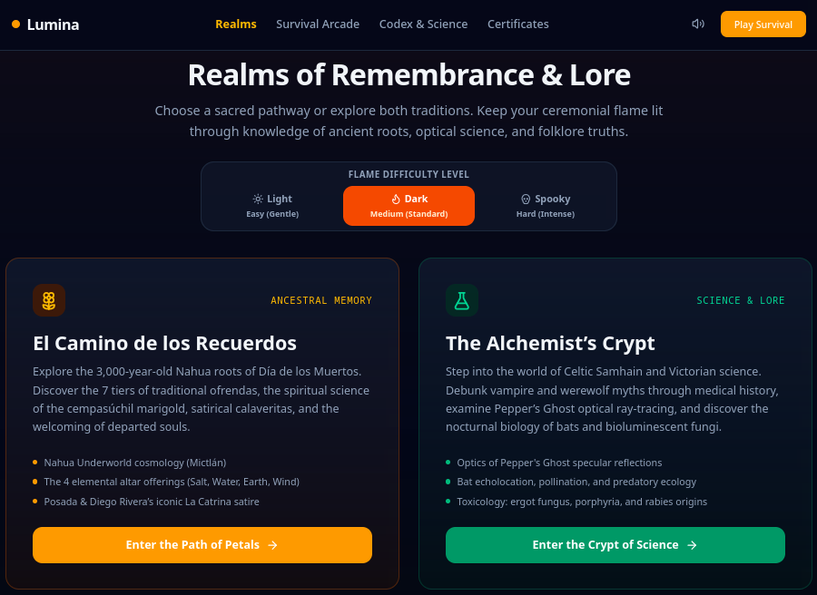
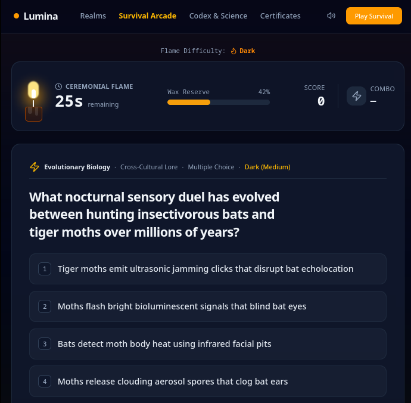
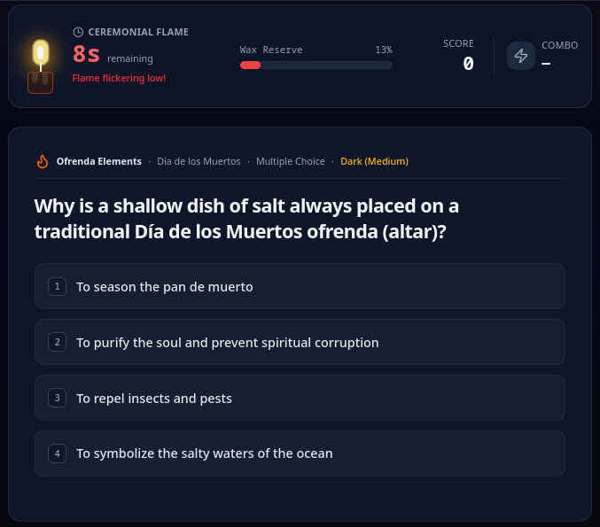
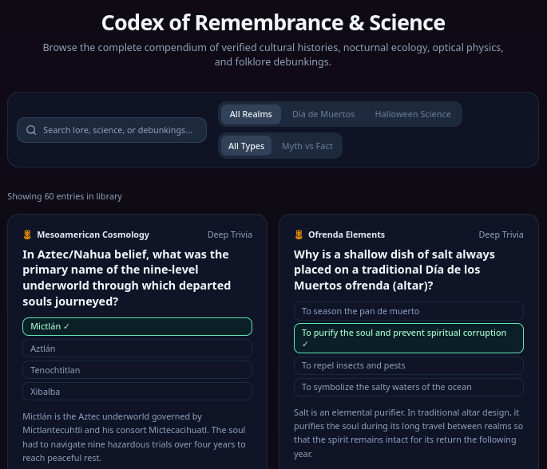
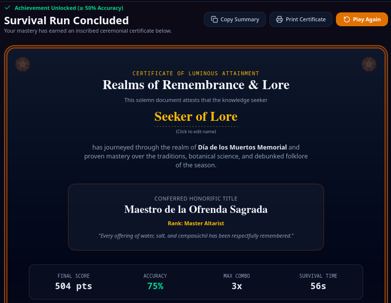

# 🕯️ Lumina: Realms of Remembrance & Lore

> An educational, responsive trivia arcade bridging the sacred ancestral traditions of **Día de los Muertos** with the natural history, optics, and folklore science of **Gothic Halloween**.

Built with React 19, TypeScript, Tailwind CSS, and Web Audio API as a **100% static, client-side web application**.

Deployed to [GitHub Pages](https://dmytrovoytko.github.io/lumina-spookyedu/) - check it out! 👻



## 🌟 Key Features

### 1. Dual-Realm Architecture & Cross-Tradition Hybrid Mode
- **El Camino de los Recuerdos (Día de los Muertos)**:
  - 3,000-year-old Nahua cosmology (*Mictlán*, *Mictecacihuatl*, *Cihuateteo*).
  - The 4 elemental offerings (*salt, water, copal resin, perforated papel picado*).
  - The botanical chemistry and scent guidance of *cempasúchil* marigolds.
  - José Guadalupe Posada and Diego Rivera’s satirical *La Catrina*.
  - Ancient burial archaeology (*jade beads in the mouth*) and Purepecha candlelit boat vigils on Lake Pátzcuaro.
- **The Alchemist’s Crypt (Halloween Science & Gothic Lore)**:
  - Celtic *Samhain* harvest markers and the turn of the agricultural year.
  - *Pepper’s Ghost* Victorian optics and 45° specular reflection physics.
  - Nocturnal biology: bat echolocation, ultrasonic moth counter-clicks, and predatory owl vision (*tapetum lucidum*).
  - Food biochemistry: pumpkin *beta-carotene* and antifungal vinegar preservation.
  - Medical debunkings of vampire and werewolf lore (*porphyria, ergotism, rabies, clinical lycanthropy*).
- **The Liminal Crossroads (Hybrid Mode)**:
  - Alternates seamlessly between both traditions for the ultimate seasonal mastery test.


### 2. Ticking Candle Survival Engine

- **Animated SVG Candle**: The ceremonial flame and melting wax indicate your remaining time and vitality.



- **Dynamic Pressure**: Correct answers replenish the flame; errors cause a puff of smoke and cost precious seconds.



- **Combo Multipliers**: Consecutive streaks (3x, 5x, 10x) trigger luminous flame flares and harmonic audio fanfares.

- **Keyboard Shortcuts**: Answer with `1-4` for multiple-choice, `M` (Myth) or `F` (Fact), and `Space`/`Enter` for the next question.


### 3. Three Thematic Difficulty Levels
- **☀️ Light (Easy)**: Gentle flame (50s timer, +7s on correct, -5s penalty; foundational folklore & cultural symbols).
- **🔥 Dark (Medium)**: Standard flame (45s timer, +6s on correct, -6s penalty; nuanced historical roots & optical physics).
- **💀 Spooky (Hard)**: Restless flame (35s timer, +5s on correct, -7s penalty; deep Mesoamerican cosmology & complex biochemistry).


### 4. 60 Verified Pre-Seeded Questions
- **100% Offline-Ready**: Every question is culturally vetted, scientifically grounded, and pre-bundled into the client.
- **Format Balance**: 36 deep 4-choice questions + 24 rapid "Myth vs. Fact" debunking cards.
- **Detailed Explanations**: Instant post-answer educational drawer providing historical context, Latin botanical names, or primary research citations.

| Realm | Light (Easy) | Dark (Medium) | Spooky (Hard) | Total |
| :--- | :---: | :---: | :---: | :---: |
| **Día de los Muertos** | 11 | 9 | 6 | **26** |
| **Halloween Science** | 9 | 9 | 8 | **26** |
| **Cross-Tradition Hybrid** | 2 | 3 | 3 | **8** |
| **Total** | **22** | **21** | **17** | **60** |




### 5. 50% Achievement Gating & Illustrated Certificate
- **Certificate of Luminous Attainment (Score $\ge$ 50% & $\ge$ 1 correct)**:
  - Awards an honorific title (e.g., *Guardián Supremo de Mictlán*, *Master of Light, Optics & Nocturnal Lore*, *Keeper of the Dual Gates*).
  - Displays ceremonial wax seal or golden calavera medallion.
  - In-place editable player name.
  - **Knowledge Digest**: Bulleted session recap of real-world facts mastered during the run.
  - Export: Print/Save as PDF via isolated `@media print` CSS or copy a text summary card.
  - Automatically saved to the in-app **Certificate Archive**.
- **Embers of Learning Screen (Score $<$ 50%)**:
  - Supportive review screen acknowledging effort without an unearned certificate.
  - Provides an educational breakdown of the questions missed with full explanations.
  - Quick action to "Re-ignite Flame & Try Again" or "Study Lore in Codex".




### 6. Built-in Procedural Audio Synthesizer
- Uses the native **Web Audio API** to procedurally synthesize gentle flame crackles, melodic chimes, streak fanfares, penalty whooshes, and ceremonial gongs.
- **Zero external audio files**: 100% reliable, zero network latency, no CORS or 404 risks.
- Includes a persistent mute/unmute toggle in the top bar.


### 7. Interactive Codex Explorer & AI Question Generator
- **Codex Explorer**: Search and read all 60 facts, science topics, and myth debunkings outside of game mode.
- **Infinite AI Question Generator**: Expand the active deck on demand with client-side procedural synthesis or connect an optional Gemini API key.


## 🛠️ Tech Stack

- **Framework**: React 19 + TypeScript
- **Styling**: Tailwind CSS v4 (dark mode, responsive, isolated `@media print`)
- **Icons**: Lucide React
- **Audio**: Web Audio API (procedural synthesis)
- **Build Tool**: Vite (configured with relative `base: './'` for GitHub Pages)
- **Testing**: Node.js test runner via `tsx --test`


## 🚀 Getting Started

### Prerequisites
- Node.js (v20+ recommended)
- npm

### Installation & Local Development
```bash
# Install dependencies
npm install

# Start local development server
npm run dev
```
Open [http://localhost:3000](http://localhost:3000) in your browser.

### Building for Production
```bash
# Build the static production bundle
npm run build
```
The compiled static website will be in the `dist/` directory, ready to be hosted on any static web server.

### Running Unit Tests
```bash
# Run the 16 unit tests
npm test
```

**Want to check it out?** **Simply click** [Lumina on GitHub Pages](https://dmytrovoytko.github.io/lumina-spookyedu/).

🎃💀 Have fun! 👻
